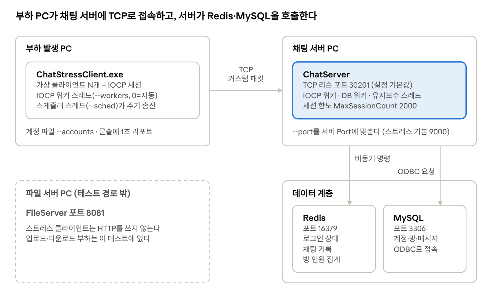

# ChatStressClient — IOCP 세션 기반 채팅 스트레스 테스트 클라이언트

ChatStressClient는 CIocpSession 기반 가상 클라이언트 N개를 한 IOCP 위에서 구동해 채팅 서버에 부하를 주는 스트레스 테스트 클라이언트다.

## 구성

`CChatClientSession`과 같은 구조다. `CIocpSession`을 상속하고, `OnConnected`에서 `LoginReq`를 보내며, 헤더 기반 `OnRecv`로 패킷을 자른다. `CNetworkFactory::CreateClientService`로 `CIocpClientService`를 만들어 가상 클라이언트를 한 IOCP 위에서 돌린다.

| 파일 | 역할 |
|---|---|
| `ChatStressSession` | `CIocpSession` 기반 가상 클라이언트. 로그인·방 입장·수신 통계·RTT, 주기 송신 Tick |
| `ChatStressScheduler` | 세션 레지스트리와 주기 송신 스레드. 세션 번호 % 스레드 수로 분담 |
| `ChatStressAccounts` | `--accounts` 파일에 public_id와 token을 저장·재사용해 재실행 시 신규 가입을 막는다 |
| `ChatStressOptions` / `ChatStressConfig` / `ChatStressStats` / `ChatStressReporter` | 실행 옵션 구조체(`SChatStressOptions`, 기본값), 설정 클래스(`CChatStressConfig`: JSON 읽기·쓰기, 서버의 `CChatServerConfig`와 같은 형태)와 명령행 파싱, 히스토그램·카운터, 출력. 시계는 `ptime::MonotonicNowMicros()` |
| `ChatStressMain` | `wmain`. 서비스 생성, 램프업, 1초 리포트, 종료 |

## 물리 구조

부하 PC가 채팅 서버에 TCP로 접속하고, 채팅 서버가 Redis와 MySQL을 호출한다. 파일 서버는 이 테스트의 부하 경로에 들어가지 않는다.



*스트레스 테스트 물리 구조 · 장비 4대, 연결 3개*

파란 박스가 부하를 받는 대상(ChatServer)이고, 점선은 이 테스트에 쓰이지 않는 장비다.

## 장비별 역할과 연결

부하는 부하 PC에서 채팅 서버로 한 방향으로 흐른다. 채팅 서버는 계정·방·메시지는 MySQL에, 로그인 상태·채팅 기록·방 인원 집계는 Redis에 기록한다.

| 장비 | 프로세스 | 역할 | 부하 조건과 연결되는 설정 |
|---|---|---|---|
| 부하 발생 PC | `ChatStressClient.exe` | 가상 클라이언트 N개를 한 IOCP 위에서 구동한다. 접속 직후 `LoginReq`를 보내고, 스케줄러 스레드가 채팅·목록 조회를 주기적으로 보낸다. | `--clients`, `--ramp`, `--workers`, `--sched`, `--chat`, `--list` |
| 채팅 서버 PC | `ChatServer` | 부하를 받는 대상이다. IOCP 워커가 수신하고, DB 요청은 DB 워커가, 지연 작업과 하트비트는 유지보수 스레드가 맡는다. | `Port`, `MaxSessionCount`(2000), `WorkerThreadCnt`, `DbWorkerThreadCnt`(4), `RedisPoolSize`(8) |
| Redis | `Redis` | 로그인 상태, 방 채팅 기록, 방 멤버 집계 같은 실시간 데이터를 다룬다. 연결 풀이 가득 찬 뒤의 요청은 대기 큐(상한 2000)에 쌓이고, 상한을 넘으면 등록에 실패한다. | `RedisPoolSize`, `RedisNode` |
| MySQL | `MySQL` | 계정·방·메시지처럼 영구히 남아야 하는 데이터를 ODBC 커넥션 풀로 처리한다. | `DBNode`, `DbWorkerThreadCnt` |
| 파일 서버 PC | `FileServer` | 이 테스트에서는 쓰이지 않는다. 스트레스 옵션에 업로드·다운로드 부하가 없다. | — |

### 연결과 포트

| 구간 | 프로토콜 | 포트 | 주의 |
|---|---|---|---|
| 부하 PC → 채팅 서버 | TCP, 커스텀 바이너리 패킷 | 서버 `Port`(설정 기본 30201) | 스트레스의 `--port` 기본값은 9000이다. 서버 설정과 맞추지 않으면 접속이 실패한다. |
| 채팅 서버 → Redis | RESP(TCP), 비동기 명령 + 콜백 | 설정 예 16379 | 일시적 연결 오류는 지연을 두고 재시도한다. |
| 채팅 서버 → MySQL | ODBC | 설정 예 3306 | DB 요청은 별도 큐에 쌓여 비동기로 처리된다. |

### 가상 클라이언트 하나의 진행

1. 점진 접속: `--ramp` 속도로 세션을 하나씩 늘린다. `--ramp 0`이면 전부 한 번에 연결한다.
2. 로그인: 연결이 완료되면 `OnConnected`에서 곧바로 `LoginReq`를 보낸다. `--accounts` 파일에 계정이 있으면 저장된 public_id와 token으로 재접속하고, 없으면 신규 가입해 파일에 저장한다.
3. 방 입장: `--room`이 0보다 크면 로그인 후 그 방(`--room-spread`이면 세션 번호 기준으로 분산)에 들어간다. 0이면 로비에 머문다.
4. 주기 송신: 스케줄러 스레드가 세션별로 채팅(`--chat`), 방 목록(`--list`), 방 멤버 목록(`--members`), 동접자 수(`--count`) 요청을 각자의 간격으로 보낸다. 간격이 0이면 그 요청은 보내지 않는다.
5. 측정: 응답이 돌아오면 수신 통계와 RTT를 기록하고, 1초마다 상태 한 줄, 종료 시 백분위 요약을 출력한다. 시계는 부하 PC 안의 `ptime::MonotonicNowMicros()` 하나라, PC 사이 시각 동기화가 필요 없다.

### 서버가 부하를 걸러 내는 지점

아래 세션별 한도는 채팅 서버가 될 수 있어, 설정한 부하가 그대로 도달하지 않을 수 있다.

| 제한 | 값 | 스트레스 옵션과의 관계 |
|---|---|---|
| 채팅 전송 빈도 | 세션당 초당 10건 | `--chat`이 100ms보다 짧으면 초과분은 서버가 폐기한다. 이보다 빠른 간격은 부하를 늘리지 못한다. |
| 수신 패킷 수 | 세션당 초당 200개 | 넘으면 서버가 연결을 끊는다. 채팅·목록·멤버·동접자 요청을 합친 빈도가 이를 넘지 않게 잡는다. |
| 방 입장 간격 | 500ms | 방 입장은 이 간격으로 제한된다. |
| 동시 세션 수 | `MaxSessionCount`(설정 기본 2000) | `--clients`가 이 값을 넘으면 서버 설정부터 올린다. |
| 유휴 연결 | 채팅 서버는 유휴 타임아웃이 꺼져 있다 | `--chat 0 --list 0`으로 접속만 유지해도 세션이 끊기지 않는다. |

### 배치 구성과 주의

| 구성 | 쓰임새 | 주의 |
|---|---|---|
| 한 PC(기본 `--host 127.0.0.1`) | 기능 확인, 개발 | 부하 PC와 서버가 CPU·메모리를 함께 쓰고 루프백이라 NIC를 거치지 않는다. 수치는 참고용이다. |
| 부하 PC 1대 + 서버 PC 1대(Redis·MySQL은 서버 PC에 동승) | 일반 부하 테스트 | Redis·MySQL이 채팅 서버와 자원을 나눠 쓴다. |
| 부하 PC, 채팅 서버, 데이터 계층 분리 | 병목 지점 분리 측정 | 네트워크 왕복 시간이 RTT에 포함되고, 서버 포트·Redis·MySQL 포트를 방화벽에서 열어야 한다. |
| 부하 PC 여러 대 | 부하 PC 한 대의 한계를 넘을 때 | `--accounts` 파일은 PC마다 따로 두고, `--prefix`를 다르게 주면 닉네임이 겹치지 않는다. |

부하 PC 자체가 포화되면 RTT에 클라이언트 쪽 지연이 섞여 서버 성능이 실제보다 나쁘게 보일 수 있다. 시험 중에는 부하 PC의 CPU 사용률도 함께 본다.

## 프로젝트 설정 (Visual Studio)
1. `ChatStressClient.vcxproj`를 기존 솔루션(ChatClient가 있는 솔루션)에 추가.
2. ChatClient 프로젝트의 `pch.h` / `pch.cpp`를 이 폴더에 복사(소스가 `#include "pch.h"` 사용).
3. `ChatStressPaths.props`의 `ServerCoreInclude`, `ChatSrcDir`, `ServerCoreLibDir`, `ServerCoreLib`를 ChatClient 프로젝트와 동일하게 수정.
4. 문자 집합 Unicode(wmain, `_tstring`=wstring 가정).

## 실행 파라미터
옵션을 모두 생략하면 기본값으로 실행한다. 인자는 `--key value` 또는 `--key=value` 형식이다(`UtilCore/Util/MainArgParser.h`의 `CMainArgParser`). 우선순위는 명령행 > 설정 파일(`--config`) > 내장 기본값이다. 값이 숫자가 아니거나 아래 범위를 벗어나면(설정 파일과 같은 범위) 사유를 로그로 남기고 사용법을 출력한 뒤 종료 코드 1로 끝난다. `--help`는 사용법만 출력하고 종료 코드 0으로 끝난다. 목록에 없는 인자는 오류 없이 무시되므로 옵션 이름 오타에 주의한다.

| 옵션 | 값 | 기본값 | 설명 |
|---|---|---|---|
| `--config` | 파일 경로 | (없음) | 실행 옵션을 읽을 JSON 설정 파일(아래 "JSON 설정 파일"). 이 파일을 먼저 읽고 나머지 인자가 그 값을 덮어쓴다. 위치는 상관없다 |
| `--host` | 주소 | `127.0.0.1` | 접속할 서버 주소 |
| `--port` | 정수 | `9000` | 접속할 서버 포트(1~65535) |
| `--clients` | 정수 | `100` | 가상 클라이언트 수(`CChatClientSession`과 같은 종류의 IOCP 세션). 1 이상 |
| `--workers` | 정수 | `0` | IOCP 워커 스레드 수. `0`=자동(하드웨어 코어 수) |
| `--sched` | 정수 | `2` | 주기 송신(채팅/목록/…)을 돌리는 스케줄러 스레드 수. 세션 번호 % 스레드 수로 분담. 1 이상 |
| `--duration` | 초 | `60` | 테스트 시간. `0`=Ctrl+C까지 무한 |
| `--ramp` | 숫자/초 | `50` | 초당 신규 접속 수(소수 가능). `0`=전부 한 번에 접속(burst) |
| `--chat` | ms | `1000` | 클라이언트당 채팅 송신 간격. `0`=송신 안 함 |
| `--list` | ms | `5000` | 방 목록 조회 간격. `0`=조회 안 함 |
| `--members` | ms | `0` | 방 멤버 목록 조회 간격. `0`=조회 안 함. 방 입장(`--room`) 상태에서만 의미 있음 |
| `--count` | ms | `0` | 동접자 조회 간격. `0`=조회 안 함 |
| `--room` | 방 번호 | `0` | 로그인 후 입장할 방. `0`=로비 유지 |
| `--room-spread` | 정수 | `1` | 1 이상. `1`보다 크면 `room` ~ `room+n-1`번 방에 세션 번호 기준 순환 분산 |
| `--msg-bytes` | 정수 | `32` | 채팅 본문 길이(바이트). 패킷 본문 버퍼 크기를 넘길 수 없음 |
| `--page-size` | 정수 | `20` | 목록 조회 요청(방 목록/멤버 목록)의 pageSize. 1 이상 |
| `--prefix` | 문자열 | `S` | 신규 가입 닉네임 접두어. ASCII만 허용(그 외 문자는 `_`로 치환). 닉네임 = 접두어 + 4자리 실행 태그 + 5자리 번호이며 16자 이내여야 함 |
| `--accounts` | 파일 경로 | (없음) | 계정(public_id+token) 저장/재사용 파일. 지정하면 재실행 시 신규 가입 대신 재접속 |

## JSON 설정 파일
`--config <file>`로 실행 옵션을 JSON 파일에서 읽는다(`ChatStressClient.json`이 예시, UTF-8). 키는 모두 선택이며 없는 키는 기본값을 쓴다. 키 이름은 옵션 구조체 필드 이름의 PascalCase다.
`CChatStressConfig::Init()`이 `CJSONConfigFieldReader`로 타입과 범위를 검증하며 읽고, 형식이 틀리거나 범위를 벗어난 값이 하나라도 있으면 로그에 모아 남기고 실행하지 않는다. 최상위가 JSON 객체가 아니어도 실패한다. 알 수 없는 키는 경고만 남기고 무시한다. `Save()`는 기존 파일의 모르는 키와 키 순서를 보존한 채 알고 있는 값만 교체한다.

| 키 | 명령행 옵션 | 기본값 | 형식 |
|---|---|---|---|
| `Host` | `--host` | `127.0.0.1` | 문자열 |
| `Port` | `--port` | 9000 | 정수 1~65535 |
| `Clients` | `--clients` | 100 | 정수 ≥1 |
| `Workers` | `--workers` | 0 (자동) | 정수 ≥0 |
| `SchedThreads` | `--sched` | 2 | 정수 ≥1 |
| `DurationSec` | `--duration` | 60 (0=무한) | 정수 ≥0 |
| `RampPerSec` | `--ramp` | 50 (0=한 번에 접속) | 숫자 ≥0 |
| `ChatIntervalMs` | `--chat` | 1000 (0=안 함) | 정수 ≥0 |
| `ListIntervalMs` | `--list` | 5000 (0=안 함) | 정수 ≥0 |
| `MemberIntervalMs` | `--members` | 0 (0=안 함) | 정수 ≥0 |
| `CountIntervalMs` | `--count` | 0 (0=안 함) | 정수 ≥0 |
| `RoomId` | `--room` | 0 (로비) | 정수 ≥0 |
| `RoomSpread` | `--room-spread` | 1 | 정수 ≥1 |
| `MsgBytes` | `--msg-bytes` | 32 | 정수 ≥0 |
| `PageSize` | `--page-size` | 20 | 정수 ≥1 |
| `Prefix` | `--prefix` | `S` | 문자열(ASCII 외 문자는 `_`로 바뀜) |
| `AccountsFile` | `--accounts` | 없음 | 문자열 |

상대 경로(`AccountsFile` 포함)는 실행한 위치 기준이다.

## 실행 방법

### 실행 예
- 점진 접속: `ChatStressClient --host 127.0.0.1 --port 9000 --clients 1000 --ramp 100 --chat 1000`
- 한 번에 접속(burst): `--ramp 0`
- 방 입장 + 멤버 목록: `--room 1 --members 2000`
- 계정 재사용: `--accounts stress_accounts.dat` (첫 실행에 가입, 이후 재접속)
- 설정 파일: `ChatStressClient --config ChatStressClient.json` (파일 값 위에 `--clients 5` 같은 인자를 덮어쓸 수 있다)

### 배치파일 (ChatStressClient.bat)
`ChatStressClient.bat`은 `Bin\x64\Release\ChatStressClient64.exe`를 `--config ChatStressClient.json`으로 실행하는 스크립트다. 배치파일 상단 주석에 옵션과 JSON 키 설명이 들어 있고, 부하 조건은 JSON 파일의 값을 고쳐 바꾼다.

```bat
@ECHO OFF
..\Bin\x64\Release\ChatStressClient64.exe ^
    --config ChatStressClient.json
PAUSE
```

1. 배치파일은 ChatStressClient 폴더 기준으로 `..\Bin\x64\Release\ChatStressClient64.exe`를 실행한다(Chat.sln의 출력 폴더 기준. 경로가 다르면 배치파일의 exe 경로를 고친다).
2. 서버를 먼저 띄운 뒤 배치파일을 더블클릭하거나 명령 프롬프트에서 실행한다. 상대 경로(`ChatStressClient.json`, `AccountsFile`)는 실행한 위치(현재 디렉터리) 기준이다.
3. 부하 조건을 바꾸려면 `ChatStressClient.json`의 값을 고친다. 한 번만 바꿔 보려면 배치파일의 `--config` 줄 뒤에 `^`로 이어 인자를 더한다(명령행이 파일 값을 덮어쓴다). 줄 끝의 `^`(줄 잇기)는 뒤에 공백 없이 붙여야 한다.
4. 실행 중에는 1초마다 상태 한 줄이 출력되고, 종료 시(`DurationSec` 경과 또는 Ctrl+C) 접속/로그인/송수신/RTT 백분위 요약이 출력된다. 끝나면 `PAUSE`로 창이 유지된다.
5. 지금 JSON 파일의 설정은 동시 1000 클라이언트를 초당 100개씩 접속시켜 30초간 채팅 1초, 방 목록 5초 간격으로 부하를 주고, 계정을 `ChatStressAccounts.txt`에 저장해 재실행 때 재사용한다.

### 용도별 옵션 조합
- 접속/로그인만 확인: `--chat 0 --list 0`
- 방 부하(채팅 + 멤버 목록): `--room 1 --members 2000`
- 여러 방에 분산: `--room 1 --room-spread 10`
- 순간 접속 폭주: `--ramp 0`
- 종료 없이 계속: `--duration 0`

## 가정(확인 필요)
- `CIocpClientService::ConnectOneMoreSession()`이 public (램프업에 사용). private이면 `--ramp 0`(burst)만 사용 가능.
- ramp 모드는 서비스를 세션 수 0으로 만든다 (Start()는 워커만 구동).
- `CIocpSession::Send(const void*, uint16)`가 워커 밖(스케줄러 스레드)에서 호출 가능 — `CChatClientMain::SendChat()`이 콘솔 스레드에서 쓰는 경로와 동일.
- `CIocpSession::Send`의 반환값은 bool(IocpSession.cpp 시그니처 기준).
