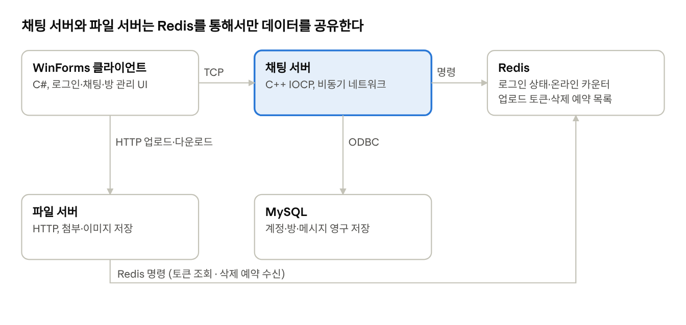
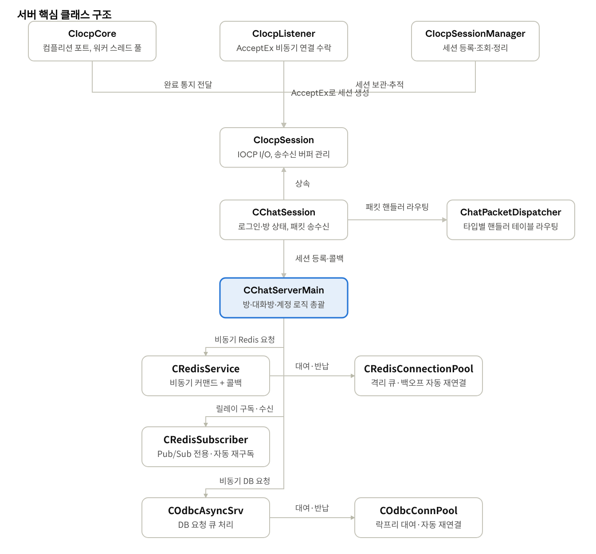
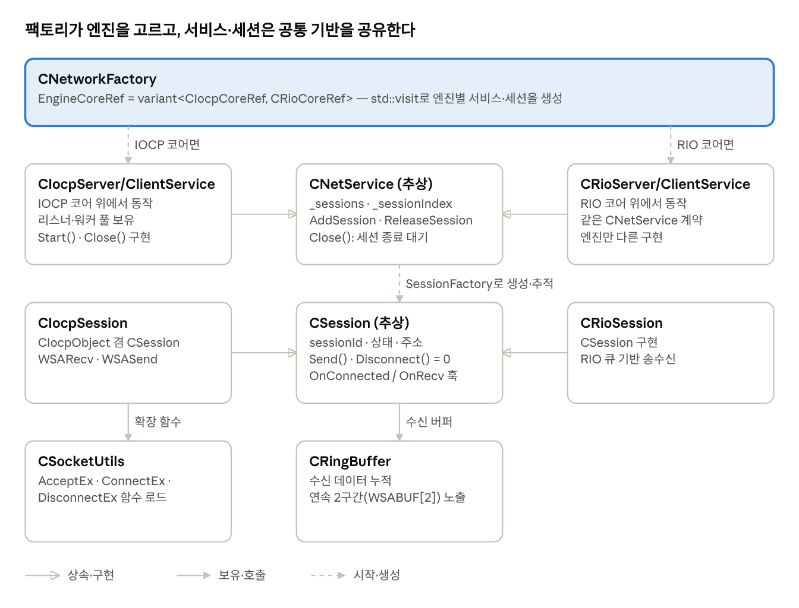
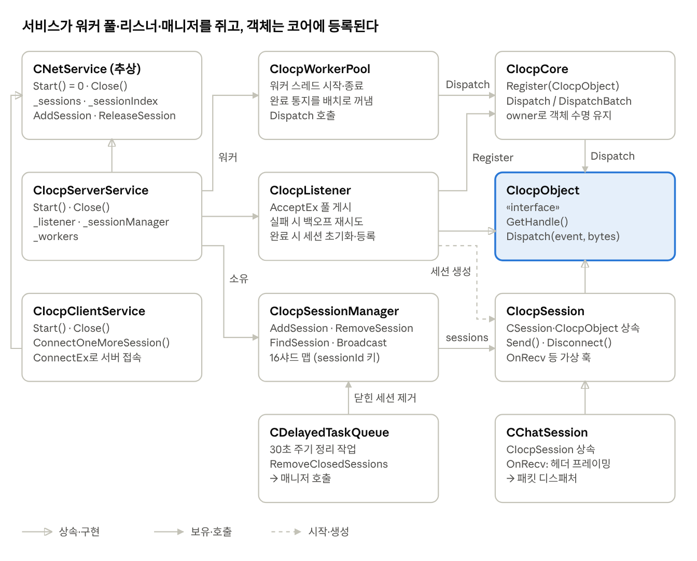
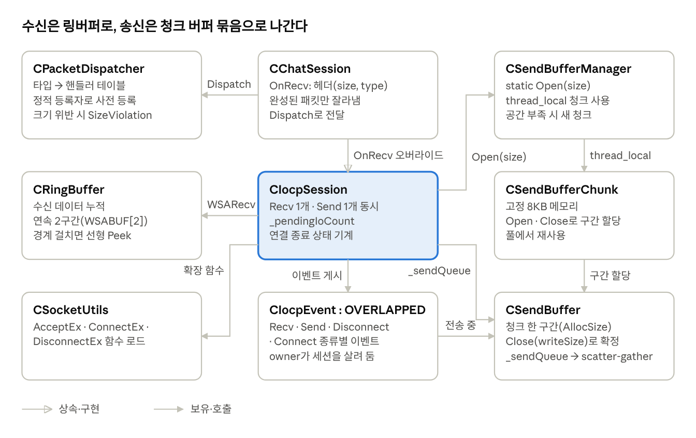
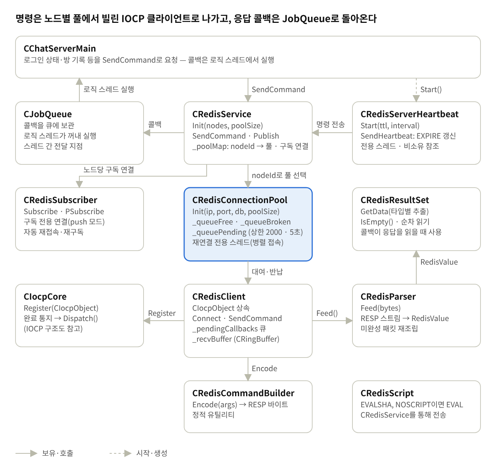
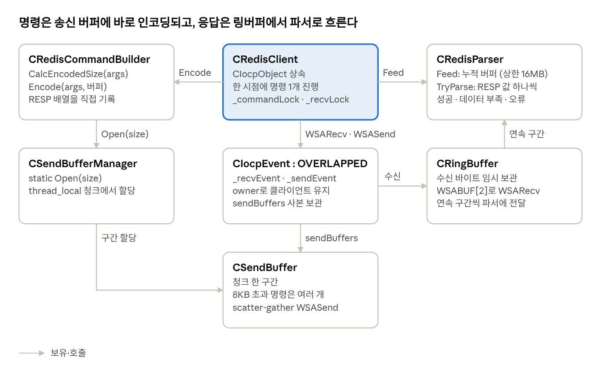
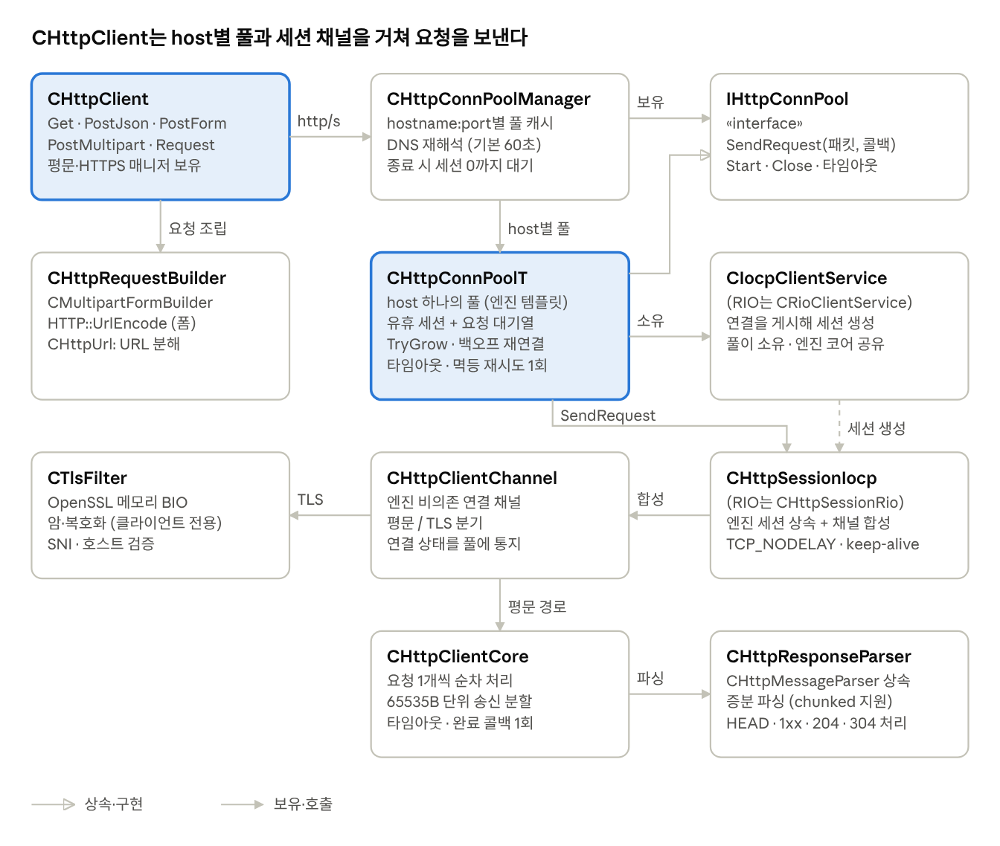
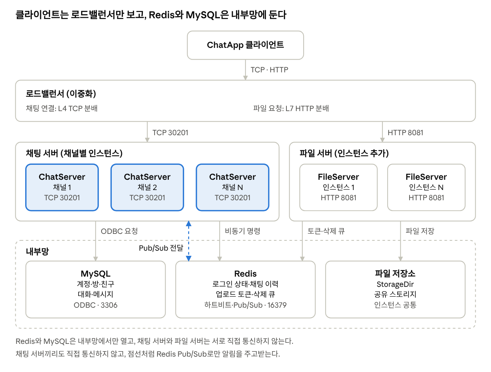

# ChatApp 컨셉 가이드

Oct 2, 2026 · 성준

## 개요

ChatApp은 C++ IOCP 기반 채팅 서버와 C# WinForms 클라이언트로 구성된 TCP 메신저 프로젝트다. 로비·채팅방, 말풍선 채팅, 파일 첨부, 프로필 갤러리, 방 관리, 친구·차단, 친구 기반 1:1·그룹 대화(메신저)까지 실제 메신저에 준하는 기능을 갖추되, 서버 쪽은 고성능 비동기 네트워크 서버가 실무에서 쓰는 패턴(IOCP, 커넥션 풀, Redis 캐시, MySQL 영속화)을 그대로 적용한다.

## 핵심 컨셉

백엔드/서버 개발자가 비동기 네트워크 서버의 실전 설계 패턴을 직접 손으로 구현하며 익히는 것이 이 프로젝트의 중심 목적이다. 커넥션 풀, 비동기 DB 요청 큐, Redis를 통한 실시간 카운터, 프로토콜 확장(페이지네이션·요청 ID) 같은 서버 패턴을 다루되, 그 결과물이 카카오톡처럼 친숙한 UX로 바로 체감되도록 클라이언트까지 함께 완성한다.

- 서버 아키텍처 학습이 1차 목표, 메신저 UI는 그 결과를 검증하고 보여주는 수단
- 사내·사설 환경에서 쓰는 걸 전제로 한 데모/학습 프로젝트 — 공인망 노출용 보안 강화는 범위 밖

## 주요 기능

| 기능 | 설명 |
| --- | --- |
| 로그인·프로필 | 로컬 계정 파일(토큰) 기반 재접속, 닉네임 변경, 프로필 이미지(URL·업로드·로컬 파일) |
| 로비·채팅방 | 방 동적 생성·삭제·이름변경, 방장 자동 위임, 방 프로필 이미지 |
| 채팅 | 말풍선 UI, 파일 첨부(진행률 표시), 링크 미리보기, 메시지 삭제 |
| 방 목록 | 전체 방 / 내 방 탭, 페이지네이션, 이름 검색 |
| 방 멤버 목록 | 현재 접속자 / 전체 참여 이력 탭, 유저별 접속 상태 |
| 친구 | 닉네임으로 친구 요청, 받은 요청 수락·거절, 친구 삭제, 친구 목록의 실시간 접속 상태, 친구의 닉네임·프로필 이미지 변경 반영 |
| 차단 | 닉네임으로 차단·해제. 차단하면 친구 관계가 정리되고 그 사용자의 채팅이 전달되지 않는다 |
| 메신저(1:1·그룹 대화) | 친구와 1:1 대화, 여러 친구와 그룹 대화(초대·나가기·이름 변경). 대화방 목록의 안 읽은 수와 마지막 메시지 미리보기, 메시지별 "안 읽은 사람 수" 표시, 답장·삭제·사진 전송, 지난 대화 이어 보기 |
| 데스크톱 알림 | 창이 비활성일 때 새 메시지를 작업 표시줄 깜박임·트레이 풍선·알림음으로 알림. 알림 설정과 방별 음소거 |
| 프로필 갤러리 | 여러 장 업로드, 대표 이미지 지정, 삭제 |
| 스킨 | 교체 가능한 색상 테마 |
| 시스템 로그 | 연결·로그인·오류 등 이벤트 로그, 레벨별 색상 구분 |

## UI/디자인 컨셉

카카오톡 스타일을 기본 레퍼런스로 삼는다. 내가 보낸 메시지는 우측 정렬(노란 계열 말풍선), 상대는 좌측 정렬(흰색)로 구분하고, 프로필 이미지는 원형으로 표시한다.

- **카드형 레이아웃** — 각 영역(서버 접속, 채팅방, 시스템 로그)을 둥근 모서리 흰 카드로 감싸 구획을 나눈다.
- **탭 구성** — 대화·채팅방·갤러리·메신저·시스템 로그 다섯 개 탭으로 화면을 분리한다. 네이티브 탭 컨트롤의 렌더링 한계 때문에 탭 헤더는 자체 구현한 버튼으로 대체했다.
- **친구 패널** — 대화 탭의 채팅 카드 오른쪽에 붙는 패널로, 친구·요청·차단 세 하위 탭으로 나뉜다. 친구 행에는 프로필 이미지와 접속 상태가 표시되고, 오른쪽 클릭으로 삭제·차단 메뉴를 연다. 요청 도착, 접속·종료 같은 변화는 패널 하단과 시스템 로그에 알린다.
- **메신저 탭** — 왼쪽에 내 대화방 목록(상대·그룹 이름, 마지막 메시지, 시각, 빨간 안 읽은 수 배지), 오른쪽에 선택한 대화방의 말풍선 대화창과 입력창이 놓인다. 말풍선 옆의 노란 숫자는 그 메시지를 아직 읽지 않은 사람 수이고, 날짜 구분선과 시스템 안내(초대·나감·이름 변경)가 대화 사이에 들어간다. 말풍선을 오른쪽 클릭하면 답장·복사·삭제 메뉴가 열리고, 사진 말풍선을 누르면 원본 크기로 본다. 입력창은 Enter로 전송, Shift+Enter로 줄바꿈한다.
- **스킨 시스템** — 액센트 색상을 교체하면 버튼·테두리·말풍선 색이 함께 바뀌는 테마 체계. 창/페이지 배경은 가독성을 위해 스킨과 무관하게 고정된 밝은 색을 유지한다.

## 아키텍처 개요

클라이언트와 서버는 TCP 커스텀 프로토콜로 통신한다. 서버는 MySQL(계정·방·메시지 영구 저장)과 Redis(로그인 상태·온라인 카운터 등 실시간 데이터)를 함께 쓰고, 첨부파일·프로필 이미지는 별도 파일 서버가 HTTP로 처리한다.

*전체 구조 · 클라이언트·채팅 서버·파일 서버·MySQL·Redis*

채팅 서버는 클라이언트(TCP)·MySQL(ODBC)·Redis와 연결된다. 파일 서버는 채팅 서버와 직접 통신하지 않고, 클라이언트의 HTTP 요청과 Redis(업로드 토큰·삭제 예약)만 다룬다.

## 핵심 구현 포인트

### 네트워크 I/O

- IOCP 비동기 모델 — `AcceptEx` / `ConnectEx` 로 연결을 맺고, 이후 모든 송수신은 `WSARecv` / `WSASend` 완료 통지로만 진행된다. 세션당 recv 1개, send 1개까지만 동시에 진행 중인 것을 전제로 설계했다.
- 진행 중 I/O 카운트(`_pendingIoCount`) — 진행 중인 Recv·Send·DisconnectEx 완료 통지가 모두 돌아오고 종료 요청도 끝난 시점에만 세션 정리를 마무리한다. 종료 통지(OnDisconnected)는 CAS 가드로 한 번만 호출된다.
- 수신 링버퍼(`CRingBuffer`) — 버퍼 끝에서 앞으로 되감기는(wrap) 구조라, 경계를 넘는 데이터는 최대 2개의 연속 구간(`WSABUF[2]`)으로 WSARecv에 넘기고, 한 덩어리로 읽어야 할 때는 선형으로 복사해(Peek) 읽는다. 송신은 링버퍼 대신 청크 기반 `CSendBuffer`를 모아 scatter-gather로 한 번에 WSASend한다.
- 유휴 연결 정리 — 서버 서비스는 `SetIdleTimeout(ms)`로 유휴 타임아웃을 켠다(0이면 꺼짐). 켜면 5초 주기(`kIdleSweepInterval`)로 세션을 점검해, 송수신 완료가 타임아웃 동안 없던 세션을 종료 사유 `Idle`로 끊는다. 유휴 연결은 타임아웃 + 5초 이내에 정리된다. 파일 서버는 60초로 켜고 채팅 서버는 끈다.

### 데이터 계층

- DB 커넥션 풀 — ODBC 커넥션을 락프리로 대여·반납하고, 끊긴 커넥션은 백그라운드 스레드가 주기적으로 재연결을 시도한다. DB 요청은 별도 큐에 쌓여 비동기로 처리된다.
- DB 핸들러 구조 — 기능 영역(계정, 친구, 대화, 방, 프로필 이미지)마다 호출 식별자(ident)와 핸들러를 하나씩 두고, 영역 안의 연산은 `op` 값(`EAccountOp`, `EFriendOp`, `EConvOp`, `ERoomOp`, `EProfileImageOp`)으로 구분한다. 연산마다 입력과 결과 콜백이 달라 요청 구조체는 연산별로 두되 모두 영역별 기반 구조체를 상속해 `op`를 싣고, 영역마다 요청 구조체 헤더(`DB*Request.h`)와 핸들러 파일(`*DBHandler.cpp`)이 각각 하나다. 핸들러는 `op`를 보고 연산별 함수로 나누며, 커넥션을 못 얻어도 모든 연산이 자기 콜백으로 DbError를 한 번 돌려준다. 쿼리는 공용 `DbUtil::CSql`(Query·Exec·Exists·LastInsertId)로 실행해 파라미터 바인딩과 결과 읽기를 한곳에서 처리한다.
- Redis 비동기 클라이언트 — 명령 전송도 콜백 기반이며, 일시적 연결 오류는 지정 횟수만큼 지연을 두고 재시도한다(지연은 서버 유지보수 스레드의 지연 큐에 예약한다). 로그인 상태(`User:{id}`, 서버 하트비트와 같은 TTL을 걸고 접속 중인 동안 같은 주기로 갱신하므로 서버가 비정상 종료하면 TTL 안에 사라진다), 방 채팅 기록(`RoomChatOrder:{roomId}` 등), 방 멤버 집계(`RoomMembers:{roomId}`)처럼 자주 바뀌는 실시간 데이터는 Redis에, 계정·방·메시지처럼 영구히 남아야 하는 데이터는 MySQL에 둔다.
- 방 입장 이력 집계 — 입장할 때마다 MySQL에 기록을 남기는 것과 별도로 Redis Set에 사용자 ID를 추가(SADD)해두면, 방 목록에 표시할 "참여 인원수"를 매번 DB를 조회하지 않고 집합 크기(SCARD)로 즉시 구할 수 있다. 결과를 쓰지 않는 멱등 쓰기(ZREM/HDEL/DEL/SADD)는 연결 오류일 때 짧게 재시도하고, 멱등이 아닌 RPUSH나 로그인 키 DEL은 재시도하지 않는다. 채팅 서버의 Redis 키 이름과 접두어는 `Common/ChatServerKeys.h`, 파일 서버와 공유하는 키는 `Common/FileServerKeys.h`에 한 곳씩만 정의한다.

### 프로토콜 설계

- 고정 헤더 + 가변 바디 — 모든 패킷은 `#pragma pack(1)`로 패딩 없이 정렬한 `{size, type}` 헤더 뒤에 패킷별 바디가 붙는 구조다.
- 친구 목록 전송 — 최대 3,000건이 한 번에 쏟아지지 않도록 항목을 최대 20건씩 묶은 배치 패킷(`FriendListBatchRes`)으로 나눠 보내고, 마지막에 완료 응답으로 마무리한다. 배치 패킷은 담긴 건수만큼만 보내는 가변 길이다.
- 목록형 요청의 공통 패턴 — 방 목록, 방 멤버 목록, 받은 친구 요청 목록, 대화 기록처럼 여러 건을 돌려주는 요청은 `requestId`(응답과 요청을 짝짓는 식별자), `page`, `pageSize`를 공통으로 쓰고, 항목을 하나씩 스트리밍한 뒤 완료 응답으로 마무리하는 동일한 흐름을 따른다.

### 친구·차단

- 데이터 모델 — 수락된 친구 관계는 `friendships`에 한 쌍당 한 행으로 저장한다. 두 계정 id를 문자열 비교로 작은 쪽(`user_a`)·큰 쪽(`user_b`)에 정규화하므로 (A,B)와 (B,A)가 중복될 수 없다. 대기 중인 요청은 `friend_requests(from_id, to_id)`에, 차단은 방향이 있는 `user_blocks(blocker_id, blocked_id)`에 둔다. 계정이 삭제되면 세 테이블 모두 외래 키로 함께 정리된다.
- 요청 흐름 — 닉네임으로 요청을 보내면 상대에게 도착 알림이 가고, 상대가 수락하면 양쪽에 관계가 성립한다. 상대가 이미 나에게 요청을 보낸 상태라면 서로 원하는 것이므로 즉시 친구로 맺고 양쪽에 알린다. 계정당 친구는 최대 3,000명이며, 요청·수락 시 서버가 양쪽 모두의 상한을 검사한다. 자기 자신, 이미 친구, 이미 보낸 요청, 내가 차단한 상대에 대한 요청은 사유를 구분해 거절한다.
- 차단 — 차단하면 두 사람의 친구 관계와 양방향 대기 요청을 한 번에 정리하고, 상대에게는 친구 해제 알림이 간다. 차단당한 쪽이 보낸 친구 요청은 차단 사실이 드러나지 않도록 성공으로 응답하되 저장도 알림도 하지 않는다. 차단 목록은 로그인 직후 세션에 올려 두고, 방 채팅을 브로드캐스트할 때 수신자의 차단 목록에 발신자가 있으면 건너뛴다.
- 접속 상태 — 로그인한 세션은 서버 메모리의 온라인 세션 맵에 publicId로 등록되며, 같은 계정의 여러 세션이 모두 등록된다. 로그인 요청은 세션당 한 번에 하나만 처리하고 실패가 5회에 이르면 연결을 끊는다. 계정의 마지막 세션이 들어오거나 나갈 때 접속 중인 친구에게 접속·종료 알림을 보내고, 닉네임·프로필 이미지가 바뀌면 접속 중인 친구에게 변경 알림을 보낸다. 친구 목록의 접속 상태는 이 맵을 기준으로 채운다. 여러 계정의 접속 여부가 필요한 곳(친구 목록, 대화 메시지·이름 변경·삭제·읽음 알림, 대화 멤버 목록)은 계정마다 맵을 조회하지 않고 한 번의 락으로 일괄 조회한다. 알림 대상을 찾기 위한 친구 id 목록은 접속 중인 계정에 한해 메모리에 캐시하고, 수락·삭제·차단으로 친구 관계가 바뀌면 양쪽 캐시를 무효화하며 마지막 세션이 끊기면 항목을 지운다. 방 인원수 변경 알림은 입·퇴장마다 보내지 않고 유지보수 스레드가 200ms 틱마다 방당 최신 값 한 번으로 모아 보낸다.
- 수신 제한 — 세션당 초당 200패킷을 넘으면 연결을 끊고, 채팅·대화 전송은 초당 10건(초과 시 대화 전송은 TooFast 응답, 채팅은 폐기), 방 입장은 500ms 간격으로 제한한다. 알 수 없는 패킷 타입은 로그를 남기고 무시하되, 정상 패킷 없이 10회 연속되면 연결을 끊는다.
- 알림 — 요청 도착, 요청 수락(또는 맞물린 즉시 친구), 친구 해제(상대의 삭제 또는 차단), 접속 상태, 프로필 변경은 모두 요청 없이 서버가 접속 중인 상대에게 먼저 보내는 알림 패킷이다. 오프라인인 상대는 다음 로그인 때 친구 목록과 받은 요청 목록을 조회해 따라잡는다.

### 메신저(1:1·그룹 대화)

친구 기반의 비공개 대화로, 누구나 들어올 수 있는 공개 방(로비·채팅방)과는 별개의 모델이다. 한 사용자가 여러 대화방에 동시에 속하고, 서버는 접속 중인 모든 멤버에게 새 메시지를 푸시한다.

- 데이터 모델 — `conversations`(대화방), `conversation_members`(멤버·읽음 위치), `conversation_messages`(메시지) 세 테이블로 구성한다. 메시지 id(`msg_id`)는 방별이 아니라 전역 AUTO_INCREMENT라 방 안에서도 단조 증가하므로, 읽음 위치·페이지 기준·정렬 기준을 모두 이 id 하나로 쓴다. 대화방의 마지막 메시지 id는 메시지를 저장하는 같은 핸들러가 갱신해 목록 정렬과 미리보기에 쓴다.
- 1:1과 그룹 — 1:1은 두 계정당 하나만 존재해야 하므로 정규화한 `"작은id:큰id"` 키(`direct_key`)에 UNIQUE를 걸어 다시 열어도 같은 방이 열리게 한다. 그룹은 이름이 선택 사항이며 최대 100명이고, 친구만 초대할 수 있다. 1:1 대화방 나가기는 내 목록에서만 숨기며, 상대가 보내거나 내가 다시 열면 돌아온다. 그룹은 나가면 멤버에서 빠지고, 마지막 멤버가 나가면 방과 메시지가 함께 삭제된다.
- 접근 규칙 — 새로 들어온 멤버에게는 들어오기 전 대화가 보이지 않는다(멤버별 `visible_from_msg_id`). 차단 관계에서는 1:1 대화를 보낼 수 없고, 내가 차단한 사람의 메시지는 기록 조회와 안 읽은 수 집계에서 제외한다. 상대가 나를 차단한 1:1에서는 차단 사실이 드러나지 않도록 메시지를 저장만 하고 상대에게 푸시하지 않는다.
- 읽음 표시 — 멤버마다 마지막으로 읽은 `msg_id`를 저장한다. 클라이언트는 대화창을 실제로 보고 있을 때(탭이 보이고 창이 활성)만 읽음 위치를 올리고, 서버는 위치가 앞으로 갔을 때만 다른 멤버에게 알린다. 말풍선 옆의 "안 읽은 사람 수"는 멤버 목록의 읽음 위치와 이 알림으로 클라이언트가 계산한다.
- 메시지 종류 — 일반 텍스트, 사진, 시스템 안내, 삭제됨 네 가지다. 사진은 파일 서버에 올린 뒤 그 URL을 메시지로 보내며, 서버는 자기 파일 서버 소유 URL만 받아들여 외부 URL로 다른 사용자를 추적하는 악용을 막는다. 저장할 때는 호스트를 뺀 참조로 두고 보낼 때 복원하는 프로필 이미지와 같은 규약을 쓴다.
- 답장과 삭제 — 답장은 대상 `msg_id`만 저장하고, 보낸 사람 닉네임과 원문 첫 줄은 조회 시점에 조인해 채운다. 대상이 내게 보이지 않거나 삭제됐으면 "삭제된 메시지"로 내려간다. 삭제는 소프트 삭제다. 내가 보낸 일반·사진 메시지만 지울 수 있고, 본문을 비워 종류를 "삭제됨"으로 바꾼 뒤 접속 중인 모든 멤버에게 알려 목록 미리보기와 다른 메시지의 답장 인용까지 같이 바뀐다. 파일 서버의 사진 파일은 지우지 않는다.
- 기록 조회 — 대화창을 열면 가장 최근 메시지 한 페이지(최대 50건)를 받고, "이전 대화 더 보기"로 `beforeMsgId` 이전 페이지를 이어 받는다. 목록형 요청의 공통 패턴대로 요청 ID로 응답을 짝짓고, 항목을 오래된 것부터 스트리밍한 뒤 완료 응답에 더 오래된 메시지가 있는지를 담는다. 한 건을 더 읽어 그 유무를 판단한다.
- 클라이언트 동작 — 서버 푸시는 수신 스레드에서 오므로 UI 스레드로 넘겨 처리한다. 메시지는 `msg_id`로 중복을 제거하고 정렬해 에코와 기록 조회가 겹쳐도 한 번만 보인다. 대화방 목록에 없는 방의 메시지가 오면(상대가 처음 말을 걸었거나 나갔다가 되살아난 경우) 목록을 다시 받는다.
- 데스크톱 알림 — 창이 비활성이거나 최소화된 동안 상대의 새 텍스트·사진 메시지가 오면 작업 표시줄 깜박임, 트레이 풍선, 알림음으로 알린다. 풍선을 누르면 해당 대화방이 열린다. 알림 사용·내용 표시·알림음과 방별 음소거는 계정별 설정 파일로 저장한다. 앱이 실행 중일 때만 동작하는 클라이언트 기능이다.

### 동시성 보호

- 연결별 상태 초기화 — 세션 객체는 `AcceptEx` 슬롯마다 미리 만들어 두고, 새 연결이 완료될 때마다 송수신 큐·카운터 같은 연결별 상태를 명시적으로 리셋한다.
- 방 브로드캐스트 — 방 멤버 세션 목록은 락 안에서 스냅샷만 떠 두고, 직렬화와 송신은 락 밖에서 한다. 방 채팅·멤버 조회·방 삭제가 같은 스냅샷 함수를 쓴다.
- 원자적 카운터로 레이스 방지 — 연결 종료 통지가 여러 스레드에서 동시에 들어올 수 있는 지점은 `std::atomic`과 CAS 기반 가드로 한 번만 처리되도록 막는다.

## DB 스키마

MySQL의 `chat` 데이터베이스(utf8mb4, InnoDB)에 계정·방·친구·대화 데이터를 영구 저장한다. 스키마 생성 스크립트는 `DB/chat.sql`이다. 모든 테이블은 계정을 내부 순번(`uid`)이 아니라 외부 식별자 `public_id`(16바이트 난수를 16진 소문자 32자로 인코딩, `CHAR(32)`)로 참조한다. 서버와 클라이언트가 계정을 항상 `public_id`로만 다루므로 매번 변환 조회가 필요 없고, `users.public_id`의 UNIQUE 제약이 외래 키 대상이 된다. 계정이나 상위 행(방·대화방)이 삭제되면 딸린 행은 `ON DELETE CASCADE`로 함께 정리된다.

### 테이블 한눈에 보기

| 테이블 | 용도 | 기본 키 | 주요 관계 |
| --- | --- | --- | --- |
| `users` | 회원 계정 | `uid` | `public_id`, `nickname` UNIQUE |
| `user_profile_images` | 유저별 프로필 이미지 갤러리(대표 1장) | `image_id` | `users.public_id` |
| `rooms` | 동적으로 생성·삭제되는 공개 채팅방 | `room_id` | `owner_public_id` → `users` |
| `room_members` | 방 입장 이력(내가 참여한 방, 방 멤버 이력) | `(room_id, user_public_id)` | `rooms`, `users` |
| `friendships` | 수락된 친구 관계(쌍당 1행) | `(user_a, user_b)` | `users` ×2 |
| `friend_requests` | 대기 중인 친구 요청 | `(from_id, to_id)` | `users` ×2 |
| `user_blocks` | 차단(방향 있음) | `(blocker_id, blocked_id)` | `users` ×2 |
| `conversations` | 친구 기반 1:1·그룹 대화방 | `conv_id` | `direct_key` UNIQUE |
| `conversation_members` | 대화방 멤버십과 읽음 위치 | `(conv_id, user_public_id)` | `conversations`, `users` |
| `conversation_messages` | 대화 메시지 | `msg_id` | `conversations` (발신자는 FK 없음) |

### 계정·프로필

**users** — 회원 계정

| 컬럼 | 타입 | 설명 |
| --- | --- | --- |
| `uid` | BIGINT UNSIGNED, AUTO_INCREMENT | 내부 전용 순번 PK. 외부(패킷·로그·URL)에는 노출하지 않는다 |
| `public_id` | CHAR(32), UNIQUE | 외부 노출용 안정 식별자. 닉네임이 바뀌어도 고정 |
| `nickname` | VARCHAR(16), UNIQUE | 표시용 닉네임(변경 가능). 영문·숫자·밑줄·한글, 1~16글자 |
| `token_hash` | CHAR(64) | 재접속 토큰의 SHA-256 해시(16진). 원문은 저장하지 않으며 로그인마다 회전 |
| `created_at` | DATETIME | 가입 시각 |
| `updated_at` | DATETIME | 토큰 회전·닉네임 변경 등 마지막 갱신 시각 |

**user_profile_images** — 프로필 이미지 갤러리

| 컬럼 | 타입 | 설명 |
| --- | --- | --- |
| `image_id` | BIGINT UNSIGNED, AUTO_INCREMENT | 이미지 고유 ID (PK) |
| `user_public_id` | CHAR(32) | `users.public_id` 참조 |
| `image_ref` | VARCHAR(500) | 파일 서버 상대 경로(`/images/…`) 또는 외부 URL |
| `file_size` | INT UNSIGNED | 업로드한 파일 크기(바이트). 외부 URL이면 0 |
| `status` | TINYINT | 0=일반, 1=대표 프로필 이미지 |
| `created_at` | DATETIME | 업로드·등록 시각 |

대표 이미지는 별도 캐시 컬럼 없이 `status = 1`인 행으로만 판단한다(`user_public_id, status` 인덱스). 대표로 지정할 때는 같은 `image_ref`의 기존 행이 있으면 재사용하고 없으면 새 행을 만든 뒤, 한 번의 UPDATE로 그 행만 1로 올리고 나머지를 0으로 내린다. 갤러리 목록은 최신순(`created_at`, `image_id` 내림차순)이다.

### 방

**rooms** — 공개 채팅방

| 컬럼 | 타입 | 설명 |
| --- | --- | --- |
| `room_id` | INT UNSIGNED, AUTO_INCREMENT | 방 번호(PK). 프로토콜의 `roomId`와 같고 로비의 예약값 0과 겹치지 않는다 |
| `name` | VARCHAR(50) | 방 이름(방장이 변경) |
| `owner_public_id` | CHAR(32) | 방장 계정. 방장이 나가면 서버가 남은 멤버에게 자동 위임 |
| `image_ref` | VARCHAR(500), NULL | 방 프로필 이미지 참조. NULL이면 클라이언트가 이름 기반 아바타로 대체 |
| `created_at` | DATETIME | 방 생성 시각 |

계정당 방 수 상한(`MaxRoomsPerOwner`)은 설정 파일 값이라 DB 제약이 아니라 방 생성 핸들러가 `COUNT(*)`로 확인한다.

**room_members** — 방 입장 이력

| 컬럼 | 타입 | 설명 |
| --- | --- | --- |
| `room_id` | INT UNSIGNED | `rooms.room_id` 참조 (PK 일부) |
| `user_public_id` | CHAR(32) | `users.public_id` 참조 (PK 일부) |
| `first_joined_at` | DATETIME | 처음 입장한 시각 |
| `last_entered_at` | DATETIME | 마지막 입장 시각. "내가 참여한 방"은 이 값의 내림차순 |

"입장한 적이 있다"만 기록한다. 지금 접속 중인지는 서버 메모리가 유일한 출처다.

### 친구·차단

**friendships** — 친구 관계

| 컬럼 | 타입 | 설명 |
| --- | --- | --- |
| `user_a` | CHAR(32) | 정규화된 쌍의 작은 쪽 `public_id` (PK 일부) |
| `user_b` | CHAR(32) | 정규화된 쌍의 큰 쪽 `public_id` (PK 일부, 인덱스) |
| `created_at` | DATETIME | 친구가 된 시각 |

문자열 비교로 `user_a < user_b`가 되게 저장하므로 (A,B)와 (B,A)가 중복될 수 없다. 조회는 양쪽 컬럼을 모두 본다.

**friend_requests** — 대기 중인 친구 요청

| 컬럼 | 타입 | 설명 |
| --- | --- | --- |
| `from_id` | CHAR(32) | 요청을 보낸 계정 (PK 일부) |
| `to_id` | CHAR(32) | 요청을 받은 계정 (PK 일부) |
| `created_at` | DATETIME | 요청 시각. `(to_id, created_at)` 인덱스로 받은 요청 목록을 페이지 조회 |

수락·거절·취소하면 행을 삭제한다.

**user_blocks** — 차단

| 컬럼 | 타입 | 설명 |
| --- | --- | --- |
| `blocker_id` | CHAR(32) | 차단한 계정 (PK 일부) |
| `blocked_id` | CHAR(32) | 차단당한 계정 (PK 일부, 인덱스) |
| `created_at` | DATETIME | 차단 시각 |

방향이 있다. A가 B를 차단해도 B가 A를 차단한 것은 아니다.

### 대화(메신저)

**conversations** — 대화방

| 컬럼 | 타입 | 설명 |
| --- | --- | --- |
| `conv_id` | BIGINT UNSIGNED, AUTO_INCREMENT | 대화방 id (PK). 프로토콜의 `convId` |
| `conv_type` | TINYINT | 1=1:1, 2=그룹 |
| `name` | VARCHAR(50) | 그룹 이름(비어 있을 수 있음). 1:1은 항상 빈 문자열 |
| `direct_key` | CHAR(65), NULL, UNIQUE | 1:1 전용 정규화 키 `"작은id:큰id"`. 그룹은 NULL |
| `last_msg_id` | BIGINT UNSIGNED | 마지막 메시지 id(0이면 메시지 없음). 목록 정렬·미리보기용 비정규화 값 |
| `created_at` | DATETIME | 생성 시각 |

**conversation_members** — 멤버십과 읽음 위치

| 컬럼 | 타입 | 설명 |
| --- | --- | --- |
| `conv_id` | BIGINT UNSIGNED | `conversations.conv_id` 참조 (PK 일부) |
| `user_public_id` | CHAR(32) | `users.public_id` 참조 (PK 일부) |
| `last_read_msg_id` | BIGINT UNSIGNED | 읽은 마지막 `msg_id`. 안 읽은 수의 기준 |
| `visible_from_msg_id` | BIGINT UNSIGNED | 이 id 이하 메시지는 이 멤버에게 보이지 않는다(입장 전 대화 비공개) |
| `is_active` | TINYINT | 0이면 목록에서 숨김. 1:1 나가기는 행을 지우지 않고 0으로 둔다 |
| `joined_at` | DATETIME | 참여 시각 |

**conversation_messages** — 대화 메시지

| 컬럼 | 타입 | 설명 |
| --- | --- | --- |
| `msg_id` | BIGINT UNSIGNED, AUTO_INCREMENT | 메시지 id (PK). 방별이 아니라 전역 단조 증가 |
| `conv_id` | BIGINT UNSIGNED | `conversations.conv_id` 참조. `(conv_id, msg_id)` 인덱스 |
| `sender_public_id` | CHAR(32), NULL | 발신자. 시스템 메시지는 NULL. FK를 걸지 않아 계정이 삭제돼도 메시지가 남는다 |
| `kind` | TINYINT | 0=텍스트, 1=시스템 안내, 2=사진(본문=이미지 참조), 3=삭제됨(본문 비움) |
| `body` | VARCHAR(1024) | 본문(UTF-8). 시스템 메시지는 안내 문구, 사진은 이미지 참조 |
| `reply_to_msg_id` | BIGINT UNSIGNED, NULL | 답장 대상 `msg_id`. 없으면 NULL |
| `created_at` | DATETIME | 전송 시각 |

## 서버 클래스 구조

CChatSession이 CIocpSession을 상속해 IOCP 송수신을 담당하고, 패킷은 디스패처가 타입별 핸들러로 라우팅한다. 로직은 전부 CChatServerMain에 모이고, 거기서 Redis와 DB는 각각 비동기 서비스 계층(CRedisService, COdbcAsyncSrv)을 거쳐 커넥션 풀에 접근하고, 다른 채널 인스턴스가 보낸 릴레이 메시지는 전용 구독 연결(CRedisSubscriber)로 받는다.

*서버 클래스 구조 · IOCP 엔진이 세션을 만들고 CChatServerMain이 Redis·DB를 조율, Redis 구독 연결은 채널 간 릴레이 수신*

세션 → 서버 → Redis/DB로 이어지는 호출 방향이 곧 책임의 경계다: 세션은 네트워크만, 서버는 로직만, 서비스 계층은 커넥션 관리만 맡는다.

## 네트워크 엔진 구조

네트워크 계층은 엔진(IOCP, RIO)에 독립적인 공통 기반 위에 쌓여 있다. CNetworkFactory가 IOCP 코어 또는 RIO 코어(EngineCoreRef)를 받아 std::visit로 해당 엔진의 서버·클라이언트 서비스와 세션을 만들고, CNetService와 CSession이 두 엔진이 공유하는 계약을 정의한다.

*엔진 추상화 계층 · 팩토리, 서비스·세션 기반, IOCP/RIO 구현*

CNetService는 세션 생성·추적과 종료 대기(Close)를, CSession은 세션 ID·상태·송수신 훅을 맡는다. 확장 함수(AcceptEx, ConnectEx, DisconnectEx)는 CSocketUtils가 로드하고, 수신 데이터는 CRingBuffer가 쌓는다.

### IOCP 객체 구성

IOCP 쪽은 객체를 코어에 등록해 두면 완료 통지가 왔을 때 코어가 그 객체의 Dispatch()를 호출한다는 한 가지 규칙으로 묶인다. 리스너와 세션이 모두 CIocpObject를 구현하고, 서버 서비스가 워커 풀·리스너·세션 매니저를 소유한다.

*IOCP 클래스 구조 · 서비스·코어·리스너·세션·세션 매니저*

채팅 세션(CChatSession)은 CIocpSession을 상속해 OnRecv에서 헤더 단위로 패킷을 잘라 디스패처에 넘긴다. 클라이언트 쪽 CChatClientSession과 스트레스 테스트의 CChatStressSession도 같은 CIocpSession을 상속한다.

### 세션 내부 경로

CIocpSession 안에서 수신은 CRingBuffer로, 송신은 CSendBuffer 묶음으로 갈라진다. 세션당 Recv와 Send는 각각 1개씩만 진행 중이고, 모든 I/O 요청은 CIocpEvent(OVERLAPPED)로 게시되며 이벤트의 owner가 완료 통지가 올 때까지 세션을 살려 둔다.

*세션 내부 경로 · 수신 링버퍼, 송신 청크 버퍼, 이벤트*

수신은 링버퍼에 쌓인 데이터를 CChatSession의 OnRecv가 헤더(size, type) 기준으로 완성된 패킷만 잘라 CPacketDispatcher로 넘긴다. 송신은 CSendBufferManager가 스레드별 청크(8KB)에서 구간을 열어 CSendBuffer로 주고, 세션이 _sendQueue에 모아 scatter-gather로 한 번에 WSASend한다.

## Redis 클래스 구조

Redis 계층도 IOCP 위에 얹혀 있다. CRedisClient가 CIocpObject를 구현해 연결 1개를 IOCP 코어에 등록하고, CRedisConnectionPool이 노드별로 이 클라이언트들을 빌려주고 되돌려 받는다.

*Redis 클래스 구조 · 서비스·연결 풀·구독 연결·클라이언트·파서·스크립트·하트비트*

명령은 CRedisCommandBuilder가 RESP 바이트로 만들어 보내고, 응답은 CRedisParser가 RedisValue로 조립한다. 풀의 연결이 모두 사용 중이면 요청은 대기 큐(상한 2000)에 쌓이고, 상한을 넘기면 SendCommand가 false를 반환한다. 그래서 처리량은 대체로 풀 크기 ÷ 왕복 시간으로 정해진다.

### 연결 풀 동작

- **대여·반납** — 커넥션 하나는 한 시점에 명령 하나만 진행하며, 응답 콜백이 끝나야 풀로 돌아온다. 돌아온 커넥션이 살아 있으면 대기 큐의 요청이 먼저 받아 가고, 대기 요청이 없으면 Free 큐로, 끊겨 있으면 격리 큐로 들어간다. Free 큐에서 꺼낼 때도 끊긴 커넥션은 격리 큐로 보낸다.
- **재연결** — 전용 스레드가 주기(기본 3초)마다 격리 큐를 훑는다. 클라이언트별 지수 백오프(500ms에서 시작해 최대 30초, 지터 최대 250ms)로 재시도 시점을 정하고, 이전 연결의 I/O 완료 통지가 모두 도착한 뒤에만 같은 OVERLAPPED를 재사용해 다시 연결한다.
- **세대 번호** — Clear()와 재Init()마다 증가한다. 이전 세대에서 빌려 간 커넥션의 늦은 콜백은 세대가 달라 풀 상태에 반영되지 않는다.
- **콜백 계약** — 풀이 접수한 명령(true 반환)의 콜백은 응답 또는 에러 값(연결 끊김, 전송 실패 등)으로 정확히 한 번 호출된다. 사용자 콜백이 예외를 던져도 커넥션 반납은 보장된다. 풀을 Clear()하면 대기 큐에 남은 요청은 폐기된다.
- **노드 구성** — CRedisService는 노드마다 풀을 하나씩 만들어 노드 ID로 관리하고(CClusterSpinUnorderedMap), 노드를 지정하지 않으면 첫 번째 노드를 쓴다. 모든 노드 풀이 연결된 경우에만 초기화가 성공하며, 응답 콜백은 CJobQueue를 거쳐 로직 스레드에서 실행된다.

### 클라이언트 내부 경로

CRedisClient 하나는 소켓 하나를 소유한 CIocpObject다. 접속은 논블로킹 connect와 select로 시간 제한(기본 3초)을 걸고, TCP keepalive(30초 유휴 후 10초 간격)를 켠 뒤 IOCP에 등록하고 첫 WSARecv를 게시한다. 논리 DB가 0이 아니면 SELECT까지 마쳐야 접속이 성공한다.

*Redis 클라이언트 내부 경로 · 빌더, 송신 버퍼, 이벤트, 링버퍼, 파서*

송신은 CRedisCommandBuilder가 크기를 먼저 계산하고, CSendBufferManager에서 연 버퍼에 RESP를 직접 기록한다(중간 std::string 복사 없음). 명령이 청크 크기(8KB)를 넘으면 여러 CSendBuffer로 나눠 담아 scatter-gather로 한 번에 보내고, 부분 전송은 남은 구간부터 이어 보낸다.

수신은 링버퍼의 연속 구간을 CRedisParser에 순서대로 넘기며, 파서는 미완성 데이터를 자체 누적 버퍼에 보관한다. 파서 누적 상한(16MB) 초과나 RESP 형식 오류가 나면 연결을 끊고, 대기 중이던 콜백은 사유별 에러 문자열로 완료된다. 파서는 배열 원소 수(4096)와 중첩 깊이(64)에도 상한을 둔다.

### 응답 읽기

CRedisResultSet은 RedisValue를 문자열 목록으로 펼친 뒤 GetData()로 읽기 커서를 따라 INT32, INT64, std::string, TCHAR 등 원하는 타입으로 순서대로 꺼낸다. 변환에 실패하면 커서는 그 자리에 남는다. 에러 응답과 빈 결과는 둘 다 IsEmpty()가 true이므로, 둘을 구분해야 하면 RedisValue::eType을 직접 확인한다.

### 서버 하트비트

CRedisServerHeartbeat는 서버 시작 시 `{serverName}:{serverGroupId}:{serverChannelId}` 키에 Hash로 등록 정보(포트, pid, 세션 수, 시작·갱신 시각 등)를 HSET하고 TTL(기본 15초)을 건다. 전용 스레드가 주기(기본 5초)마다 등록 필드 전체를 다시 쓰고 EXPIRE로 TTL을 갱신하므로, Redis가 재시작돼 키가 사라져도 완전한 등록 정보로 복구된다. 비정상 종료하면 TTL 만료로 항목이 자동 소멸하고, 정상 종료(Stop)는 DEL로 즉시 지운다. 갱신 주기는 TTL보다 짧아야 하며, 세션 수는 등록한 콜백(SetSessionCountProvider)이 알려 준다.

## HTTP 계층 구조

UtilCore의 Network/HTTP는 엔진(IOCP/RIO)에 의존하지 않는 HTTP/1.x 구현이다. 클라이언트 쪽(CHttpClient, 커넥션 풀, TLS)과 서버 쪽(요청 파서, 응답 빌더, 멀티파트, Range)이 같은 파서·빌더 기반을 공유한다. 파일 서버는 서버 쪽 클래스를 사용한다(파일 서버 구조 참고).

### 클라이언트 구조

*HTTP 클라이언트 구조*

- CHttpClient: URL의 scheme으로 평문/HTTPS 매니저를 골라 요청을 보낸다. SSL_CTX 없이 만들면 https 요청은 즉시 실패(success=false)로 통지된다.
- CHttpConnPoolManager: host(hostname:port)별 풀을 지연 생성해 캐싱한다. 같은 host로 첫 요청이 동시에 오면 한 스레드만 DNS 해석과 풀 생성을 맡는다. 주소는 기본 60초마다 다시 해석하고, 종료 시에는 모든 세션이 정리될 때까지 기다릴 수 있다.
- CHttpConnPoolT: host 하나의 풀이며, 세션·서비스 타입을 템플릿 파라미터로 받아 IOCP와 RIO가 같은 코드를 쓴다. 초기에는 minIdle개만 연결하고, 유휴 세션이 없어 요청이 대기열에 쌓이면 maxConnections까지 늘린다. 끊긴 연결은 지수 백오프(200ms~10초)로 다시 채우고, 멱등 요청은 1회 자동 재시도하며, 무응답 타임아웃 기본값은 30초다.
- CHttpSessionIocp / CHttpSessionRio: 엔진 세션의 훅을 CHttpClientChannel로 이어 주는 얇은 어댑터다. 채널은 평문이면 CHttpClientCore로 바이트를 직접 전달하고, HTTPS면 CTlsFilter(OpenSSL 메모리 BIO)로 암·복호화한 뒤 전달한다.
- CHttpClientCore: 커넥션 하나에서 요청을 한 번에 하나씩만 처리한다(파이프라이닝 없음). 완료 콜백은 정확히 한 번, 락 밖에서 호출한다.

### 메시지 파서와 빌더

<!-- 다이어그램 "HTTP 메시지 파서·빌더 구조": 원본 PDF에 이미지가 포함되어 있지 않음 -->

- 파서: CHttpMessageParser가 헤더·Content-Length·chunked·trailer 처리와 줄·헤더·본문 상한을 담당하고, 요청/응답 파서는 시작 줄과 본문 길이 규칙만 구현한다. 헤더 이름 앞뒤 공백, 서로 다른 Content-Length 중복처럼 메시지 경계가 모호해지는 입력은 모두 Error로 처리한다.
- 대용량 본문: CHttpRequestParser는 기본적으로 본문을 메모리에 누적하되 64MB를 넘으면 Error로 처리한다. 헤더 완료 콜백에서 본문 스트림 콜백을 걸면 본문을 누적하지 않고 흘려보내며, 요청별로 상한을 따로 줄 수 있다. 파일 서버의 업로드가 이 경로를 쓴다.
- 멀티파트: 소량 폼은 MultipartFormParser가 완성된 본문을 한 번에 해석하고, 대용량은 CMultipartStreamParser가 boundary 기준으로 파트 시작·데이터·끝 콜백을 보낸다(파트 헤더만 버퍼링).
- 빌더: char 바이트로만 조립하고 헤더는 flat vector로 보관하며, Reset으로 버퍼를 재사용한다. 요청 빌더와 응답 빌더는 CHttpBuilderBase를 공유한다.
- Range: 단일 바이트 구간만 지원한다. 다중 구간 요청은 무시하고 전체를 200으로 응답한다.

## 파일 서버 구조

파일 서버는 채팅 서버와 별개 프로세스로 동작하는 HTTP 서버다. 네트워크 계층(CIocpCore, CIocpServerService)과 Redis 계층(CRedisService), CJobQueue를 그대로 재사용하고, 세션만 HTTP를 해석하는 CFileServerSession으로 바꿨다. 채팅 서버와는 서로 직접 통신하지 않는다. 두 서버가 같은 Redis를 바라보며 업로드 토큰과 삭제 예약 목록을 주고받고, 클라이언트는 채팅 서버에서 받은 주소와 토큰으로 파일 서버에 직접 HTTP 요청을 보낸다.

<!-- 다이어그램 "파일 서버 클래스 구조": 원본 PDF에 이미지가 포함되어 있지 않음 -->

### 업로드 흐름

- 요청은 멀티파트로 받으며 본문을 메모리에 모으지 않고 저장소 하위 `.tmp` 디렉터리의 임시 파일(upload_{랜덤 hex}.tmp)에 스트리밍으로 기록한다. 저장소와 같은 볼륨이라 저장이 rename 한 번으로 끝나고, 서버 시작 시 이전 실행이 남긴 임시 파일은 비운다. 허용 크기는 MaxUploadBytes로 제한한다.
- 채팅 서버가 Redis에 발급한 일회용 토큰(UploadToken:{token})을 확인한다. 멀티파트의 `token` 파트는 반드시 파일 파트보다 앞에 와야 하며(아니면 연결을 끊는다), 토큰은 토큰 파트가 끝나는 즉시 Lua 스크립트(GET+DEL)로 원자적으로 소모한다. 같은 토큰으로 여러 연결이 동시에 업로드를 시작할 수 없고, 업로드 시간이 토큰 TTL에 묶이지 않는다. 무효면 본문을 더 받기 전에 연결을 끊고, 소유자(public_id)는 요청 단위로 세션에 보관한다. 본문 수신이 먼저 끝났다면 최종 저장 단계가 그 결과를 기다렸다가 무효이면 401로 응답한다. 업로드가 중간에 실패해도 토큰은 이미 소모되므로 클라이언트는 업로드마다 새 토큰을 발급받는다. 스크립트는 UtilCore의 CRedisScript가 EVALSHA로 보내고, Redis가 캐시를 잃으면(NOSCRIPT) EVAL로 한 번 다시 보내 적재한다. 토큰은 채팅 서버가 만드는 형식(16진 64자)이 아니면 Redis를 부르기 전에 거부하고, 토큰 필드 길이는 128자로 제한하고 다른 작은 필드는 버린다. 파일 크기 상한(MaxUploadBytes)은 본문 수신 중 스트리밍 파서가 강제한다. 파일 파트가 여럿이면 첫 번째만 받는다.
- 검증이 끝나면 저장소로 옮기고(확장자는 영숫자 8자 이하만 허용, 아니면 .bin) PublicBaseUrl 기반의 접근 URL을 응답한다.
- 상태 코드: 잘못된 요청 400, 토큰 오류 401, 크기 초과 413, 저장 실패 500, 성공 200.

### 다운로드 흐름

- Range 요청을 지원한다. 구간이 유효하면 206, 범위를 벗어나면 416으로 응답한다.
- 헤더를 보내기 전에 파일 위치를 잡아 실패하면 500으로 응답한다. 본문은 세션이 송신 완료 통지(OnSend)에 맞춰 64KB 청크로 읽어 보내며, 아직 나가지 않은 바이트가 256KB를 넘으면 멈춘다. 느린 클라이언트여도 메모리에 쌓이는 양이 상한으로 묶이고 IOCP 워커가 파일 전체를 읽느라 점유되지 않는다. 읽는 도중 파일이 짧아지면 연결을 끊는다.
- `Connection: close` 응답은 마지막 바이트의 송신 완료를 확인한 뒤 연결을 닫는다. 본문을 보내는 동안 이어지는 파이프라인 요청은 처리하지 않는다.
- Content-Type은 파일 확장자로 추정한다. 파일명이 무작위이고 내용이 바뀌지 않으므로 `Cache-Control: public, max-age=31536000, immutable`과 `X-Content-Type-Options: nosniff`를 붙인다.

### 삭제와 예약 삭제

- 파일 서버에는 HTTP 삭제 API가 없다. 삭제는 채팅 서버가 소유권을 확인한 뒤 Redis의 FileServer:PendingDeletions 목록에 대상을 넣는 방식으로만 일어난다.
- 전용 스레드 하나가 하나씩 꺼내 파일을 지운다. 꺼내는 동작은 스크립트 하나로 LPOP과 FileServer:ProcessingDeletions 목록에 넣기를 함께 수행하고, 처리가 끝나면 그 목록에서 LREM으로 지운다. 응답이 유실되거나 처리 도중 종료돼도 항목이 사라지지 않으며, 서버가 기동할 때 처리 중이던 항목을 순서를 유지해 대기 목록 앞으로 되돌린다(삭제는 멱등). 항목이 있으면 대기 없이 연속으로 비우고, 비면 5초 대기한다(서버 종료 시 Redis 응답 대기 중이어도 100ms 안에 깨어나 join한다).
- 삭제에 실패한 항목(경로 오류, 파일시스템 오류)은 큐에 되돌리지 않고 FileServer:FailedDeletions 목록에 쌓아 운영자가 확인할 수 있게 한다. 이미 없는 파일은 성공으로 본다.

### 저장소

- IFileStorage 인터페이스 뒤에 CLocalFileStorage가 있다. 저장 경로는 {baseDir}/{ownerId}/{랜덤 hex}{확장자}이며, 외부에서 들어오는 상대 경로(GET 경로, 삭제 큐)는 "{owner}/{무작위 16진 32자}.{영숫자 1~8자}" 형태(owner는 영숫자·`_`·`-`)만 받아들이고, 경로 조작과 Windows 예약어 파일명이 이 형식 검증에서 걸러지며 읽기·삭제·스트림 열기 모두 같은 검증을 거친다. 모든 응답 조립은 세션의 공용 SendSimple을 쓴다.
- 저장소를 인터페이스로 분리했으므로 다른 백엔드로 교체해도 핸들러는 바뀌지 않는다.

### 채팅 서버와의 연동 (Redis)

- 업로드 토큰: 클라이언트가 채팅 서버에 토큰을 요청하면, 채팅 서버가 무작위 32바이트(16진 64자)를 만들어 `SET UploadToken:{token} {계정 public_id} EX 60`으로 Redis에 넣는다. 응답에는 토큰과 파일 서버 주소(FileServerUrl)가 실린다. Redis가 에러를 응답하거나 명령을 큐에 넣지 못하면 토큰을 발급하지 않고 실패로 응답한다. 파일 서버는 업로드 요청이 올 때 이 키를 조회해 소비하고, 값으로 소유 계정을 알아낸다. TTL이 60초라 발급 후 곧바로 쓰지 않으면 만료된다.
- 삭제 예약: 채팅 서버가 프로필 이미지를 교체하거나 지울 때, 또는 파일 첨부 채팅 메시지(`[FILE:이름:크기]URL`)를 소유자가 삭제할 때(첨부 파일 경로가 발신자 본인 `public_id` 하위일 때만), 지워진 URL이 자기 파일 서버 소유(`{FileServerUrl}/images/...`)이면 상대 경로만 `RPUSH FileServer:PendingDeletions`로 넣는다. 외부 URL은 대상에서 제외한다.
- 이미지 URL 검증: 프로필 이미지·방 이미지를 URL로 지정할 때 채팅 서버는 URL이 비어 있거나 외부 주소면 그대로 받고, 자기 파일 서버 소유(`{FileServerUrl}/images/...`)이면 상대 경로가 위 형식 검증을 통과하고 요청자 본인 `public_id/` 하위일 때만 받는다. 아니면 `DbError`로 거절한다. 교체 시 이전 이미지가 삭제 예약되므로, 이 검사로 타인의 업로드 파일을 내 이미지로 지정한 뒤 바꿔서 삭제시키는 경로를 막는다.
- 키·경로 규약: 업로드 토큰 키 접두사·TTL, 삭제 예약/실패 목록 키, 저장 파일 상대 경로 규칙(`{owner}/{16진 32자}.{확장자}`)과 그 검증 함수는 `Common/FileServerKeys.h` 한 곳에서 정의해 두 서버가 함께 쓴다. 채팅 서버는 예약 전에, 파일 서버는 저장·조회·삭제 때 같은 규칙으로 검증한다.
- 주소 일치: 위 접두사 판별이 파일 서버가 만드는 공개 URL과 같은 형식이어야 하므로, 채팅 서버의 FileServerUrl과 파일 서버의 PublicBaseUrl은 같은 주소로 맞춘다.
- 클라이언트 경로: 채팅 서버는 파일 바이트를 중계하지 않는다. 업로드와 다운로드는 클라이언트가 파일 서버로 직접 보낸다.

### 채팅 서버 설정 (chatserver_config_mysql.json)

채팅 서버는 실행 폴더의 chatserver_config_mysql.json을 읽는다. 파일 서버와 맞물리는 항목은 FileServerUrl과 RedisNode다.

두 서버의 설정 로더는 같은 규칙을 따른다. 항목마다 타입과 범위를 검사해(예: Port 1~65535, MaxSessionCount 1 이상, 노드 ID 1~32767) 어긋나면 기동에 실패하고, 파일에 없는 키는 기본값을 유지한다. 로드한 값은 `ToOptions()`가 구동 옵션 구조체(`SChatServerOptions`, `SFileServerOptions`)로 옮겨 담고, 서버는 `Start(옵션)` 한 번으로 시작한다. 설정 파일에 없는 옵션(유휴 타임아웃 등)은 구조체의 기본값을 쓴다. 채팅 서버의 유휴 타임아웃은 꺼져 있다.

| 항목 | 설명 | 기본값 |
| --- | --- | --- |
| Name / GroupId / ChannelId | 서버 이름과 그룹·채널 식별자 | ChatServer / 1 / 1 |
| IP / Port | 수신 주소와 포트 | 127.0.0.1 / 30201 |
| KeepAliveSec | 세션 유지 시간(초) | 3000 |
| MaxSessionCount | 최대 동시 세션 수 | 2000 |
| WorkerThreadCnt | IOCP 워커 스레드 수 | 0 |
| RedisPoolSize | 노드당 Redis 연결 수 | 8 |
| DbWorkerThreadCnt | DB 비동기 워커 스레드 수 | 4 |
| HeartbeatTtlSec / HeartbeatIntervalSec | 서버 하트비트 TTL과 갱신 주기(초) | 15 / 5 |
| FileServerUrl | 클라이언트에 알려 줄 파일 서버 주소. 파일 서버의 PublicBaseUrl과 일치해야 한다 | http://127.0.0.1:8081 |
| MaxRoomsPerOwner | 계정당 만들 수 있는 방 수 상한 | 3 |
| EnableRelay | 1이면 다른 채널(인스턴스)에 접속한 사용자에게도 친구 알림·대화를 Redis Pub/Sub으로 전달. 채널들이 같은 Redis를 써야 하며, 서버가 한 대이거나 채널마다 Redis를 따로 두면 0 | 1 |
| DBNode | 접속할 DB 노드(ODBC 드라이버, 주소, DB 이름 등) | MySQL, 127.0.0.1:3306, chat |
| RedisNode | 접속할 Redis 노드. 파일 서버와 같은 Redis를 가리켜야 한다 | 1, 127.0.0.1:16379, 0 |

### 파일 서버 설정 (fileserver_config_mysql.json)

파일 서버는 `Name`만 읽는다. `ServiceName`, `DisplayName`, `GroupId`, `ChannelId` 키가 파일에 있어도 무시한다. 송수신 완료가 60초 동안 없는 유휴 연결은 끊는다(대용량 전송 중에는 완료 통지가 계속 들어와 걸리지 않는다).

| 항목 | 설명 | 기본값 |
| --- | --- | --- |
| Name | 서버 이름 | FileServer |
| IP / Port | 수신 주소와 포트 | 0.0.0.0 / 8081 |
| MaxSessionCount | 최대 동시 세션 수 | 500 |
| WorkerThreadCnt | IOCP 워커 스레드 수 | 4 |
| RedisPoolSize | 노드당 Redis 연결 수 | 4 |
| StorageDir | 파일 저장 기준 디렉터리 | ProfileImages |
| PublicBaseUrl | 클라이언트에 알려 줄 접근 URL의 기준 | http://127.0.0.1:8081 |
| MaxUploadBytes | 업로드 최대 크기 (바이트) | 5368709120 (5GB) |
| RedisNode | 접속할 Redis 노드(ID, 주소, DBIndex) | 1, 127.0.0.1:16379, 0 |

## 라이브 서비스 물리 구성과 서버 확장

### 물리 구성도

*라이브 서비스 물리 구성도 · 로드밸런서, 채팅·파일 서버, 내부망 3종, 채널 간 Pub/Sub*

클라이언트가 접속하는 곳은 로드밸런서 하나다. 채팅 연결(TCP 30201)은 파란 박스의 채널별 채팅 서버로, 파일 요청(HTTP 8081)은 파일 서버로 나뉜다. 점선 영역은 내부망으로, 두 서버가 MySQL·Redis·파일 저장소를 함께 쓴다. 채팅 서버가 여러 대일 때 서버끼리는 직접 통신하지 않고, 같은 Redis의 Pub/Sub 토픽으로 친구·대화 알림을 주고받는다. 채팅 서버를 여러 대로 늘리는 방식은 아래 "현재 구조의 확장 제약"과 "동시 접속자 수별 확장 단계"에서 다룬다.

### 구성 요소와 역할

라이브 서비스는 아래 6개 요소로 나눈다. 포트는 설정 파일의 기본값이며 환경에 맞게 바꾼다. 로드밸런서와 이중화·복제 구성은 이 구조를 운영에 올릴 때의 권장 구성이고, 코드에 들어 있는 기능이 아니다.

| 구성 요소 | 역할 | 기본 포트·프로토콜 | 의존 대상 | 확장 방식 |
|---|---|---|---|---|
| 로드밸런서 | 클라이언트 진입점. 채팅은 TCP(L4), 파일은 HTTP(L7)로 분배 | 30201 TCP · 8081 HTTP | 채팅 서버, 파일 서버 | Active-Standby 이중화 |
| 채팅 서버 | 로그인, 방, 채팅, 친구, 접속 세션 관리 (IOCP) | 30201 TCP, 커스텀 패킷 | Redis, MySQL | 채널 단위 인스턴스 추가 |
| 파일 서버 | 이미지·파일 업로드/다운로드 (HTTP) | 8081 HTTP | Redis, 파일 저장소 | 인스턴스 추가 + 공유 저장소 |
| Redis | 로그인 상태, 채팅 이력, 방 멤버, 업로드 토큰, 삭제 큐, 서버 하트비트, 채널 간 전달(Pub/Sub) | 16379 | 없음 | 복제본 + 자동 장애 조치 |
| MySQL | 계정, 방, 친구, 대화, 메시지 영속 저장 (ODBC) | 3306 | 없음 | 주-복제 |
| 파일 저장소 | 파일 서버의 `StorageDir` | 없음 | 없음 | 공유 스토리지 |

구성 원칙은 다음과 같다.

- **채팅 서버는 연결 유지형 TCP**다. 한 번 맺은 연결은 끝까지 같은 인스턴스에 머물므로, 로드밸런서는 L4에서 새 연결만 분배하면 된다. HTTP 프록시를 앞에 둘 수 없다.
- **채팅 서버와 파일 서버는 서로 직접 통신하지 않는다.** 업로드 토큰과 삭제 큐를 Redis로 주고받을 뿐이라 두 서버를 다른 호스트에 둘 수 있다. 채팅 서버의 `FileServerUrl`은 파일 서버의 `PublicBaseUrl`, 즉 클라이언트가 실제로 접속하는 공개 주소(로드밸런서 주소)와 같아야 한다.
- **파일 서버는 호스트를 분리**한다. 업로드 한도(`MaxUploadBytes`)가 5GB라 대역폭과 디스크 I/O를 크게 쓸 수 있고, 같은 호스트에 두면 채팅 서버의 IOCP 워커와 네트워크 카드를 두고 경쟁한다.
- **Redis와 MySQL은 내부망에만** 둔다. 클라이언트가 직접 닿는 것은 로드밸런서 뒤의 채팅 서버와 파일 서버뿐이다.
- **서버 하트비트**(`{serverName}:{groupId}:{channelId}`, TTL 15초, 5초 주기)는 Redis에 남으므로, 살아 있는 채팅 서버 인스턴스 목록을 운영 도구가 조회할 수 있다.
- **채팅 서버 인스턴스끼리도 직접 통신하지 않는다.** 채널 간 전달은 같은 Redis의 Pub/Sub 토픽(`Chat:{group}:{channel}`)으로만 오가므로 인스턴스를 다른 호스트에 둘 수 있다. 대신 전달(EnableRelay)을 쓰는 채널들은 Redis를 공유해야 한다.

### 현재 구조의 확장 제약

채팅 서버 한 대는 로그인 상태와 채팅 이력을 Redis에, 영속 데이터를 MySQL에 두지만, 실시간 라우팅에 쓰는 상태는 `CChatServerMain` 프로세스 메모리에 있다. 인스턴스를 여러 대로 늘리면 이 상태들이 인스턴스마다 따로 존재하게 된다. 아래는 코드에서 확인한 항목이다.

| 상태 | 위치 | 인스턴스를 여러 대 둘 때의 영향 |
|---|---|---|
| `_onlineSessions` (publicId → 접속 세션) | 프로세스 메모리 | 이 인스턴스에 접속한 사용자만 담는다. 다른 인스턴스의 사용자는 로그인 키로 채널을 조회해 릴레이로 전달한다 |
| `_roomMembers` (방 → 세션 집합) | 프로세스 메모리 | 같은 방 사용자가 다른 인스턴스에 있으면 채팅 브로드캐스트가 닿지 않음 |
| `_roomRegistry` (방 이름·방장 캐시) | 프로세스 메모리, 시작 시 DB에서 로드 | 다른 인스턴스가 만든·삭제한·이름을 바꾼 방이 반영되지 않음 |
| `_messageOwners` (최근 20,000개 메시지의 발신자) | 프로세스 메모리 | 다른 인스턴스에서 보낸 메시지의 삭제 요청은 찾지 못해 실패 |
| `_friendCache` (친구 id 목록) | 프로세스 메모리 | 친구 변경의 캐시 무효화가 다른 인스턴스로 전파되지 않음 |
| `_nextMessageId` | 프로세스 메모리, 시작 시각(ms)을 시드로 삼는 카운터 | id 하위 4비트에 채널 번호(ChannelId % 16)를 넣어 채널 간 겹치지 않게 한다. 채널 번호가 16 이상 차이 나면 겹칠 수 있다 |

이 표에서 나오는 결론은 두 가지다.

- **로그인 상태(`User:{id}`), 채팅 이력, 방 멤버 집합, 업로드 토큰은 이미 Redis에 있어** 인스턴스가 여러 대여도 공유된다. 로그인 키에는 `serverGroupId`·`serverChannelId`도 들어 있어, 사용자가 어느 인스턴스에 접속 중인지 알 수 있다. 다만 이 정보로 다른 인스턴스의 세션에 메시지를 전달하는 경로는 없다.
- 따라서 **인스턴스를 늘리는 유일한 방법은 인스턴스마다 독립된 세계(채널)로 나누는 것**이다. 다른 채널 사용자와는 방·친구 알림을 주고받지 않는 것을 전제로 한다. 하나의 DB를 공유하면 채널 B가 채널 A의 방을 시작 시 로드해 목록에 보여주는데 `DB/chat.sql` 스키마에 채널 구분 컬럼이 없으므로, 채널마다 DB를 따로 두거나 방 테이블에 채널 구분을 추가해야 한다. 채널 간 동일 세계를 원하면 인스턴스 간 메시지 전달 계층(Redis Pub/Sub 등)을 코드에 추가해야 한다.

### 동시 접속자 수별 확장 단계

확장은 코드 변경 없이 되는 것부터 순서대로 올린다. 아래 동접 구간은 인스턴스 1대의 기본 세션 한도(`MaxSessionCount` 2,000)를 기준으로 잡은 **출발점 가정**이다. 실제 경계는 ChatStressClient로 측정해 정한다.

| 단계 | 동접 구간(가이드) | 구성 | 코드 변경 |
|---|---|---|---|
| 0. 단일 서버 | ~2,000 | 채팅 서버 1대, 파일 서버 1대, Redis 1, MySQL 1 (한 호스트 가능) | 없음 |
| 1. 수직 확장 + 호스트 분리 | 2,000 ~ 수천 | 채팅 서버·파일 서버·Redis·MySQL을 각자 호스트로 분리. 설정값만 조정 | 없음 (설정) |
| 2. 채널 분할 | 수천 ~ 수만 | 채팅 서버를 `ChannelId`별로 N대. 로드밸런서·파일 서버·Redis·MySQL 복제 추가, 채널 간 친구·대화 알림은 공유 Redis로 전달 | 작음 (채널 선택, DB 분리) |
| 3. 방 단위 라우팅 | 수만 이상, 한 세계가 필요 | 방 채팅·방 멤버 상태를 기존 전달 계층(친구·대화 알림용)으로 확장 + 방·사용자 인스턴스 매핑, MySQL 읽기 복제·샤딩 | 큼 |

**0·1단계 — 설정으로 올리는 구간.**

- `MaxSessionCount`를 올리고, `WorkerThreadCnt`는 코어 수에 맞춘다. 세션 수를 올리면 수신 버퍼와 소켓 메모리도 그만큼 늘어난다.
- `DbWorkerThreadCnt`(기본 4)는 동시 DB 요청 수를 정하고, `RedisPoolSize`(기본 8)는 동시 Redis 명령 수를 정한다. Redis 대기 큐는 2,000개라서 넘치면 명령이 실패(`SendCommand`가 false)하므로, Redis 지연이 늘기 전에 풀 크기를 키운다.
- 세션별 한도(초당 패킷 200개, 채팅 초당 10개)는 세션 한 개의 상한일 뿐이다. 실제 부하는 방 인원 수로 정해진다 — 한 방에 N명이 있으면 채팅 1건이 N건의 송신이 되므로, **큰 방이 부하를 좌우한다**.
- 파일 서버는 상태가 없어(업로드 토큰이 Redis에 있다) 인스턴스를 늘려도 된다. 단 저장소(`StorageDir`)는 모든 인스턴스가 같은 공유 스토리지를 가리켜야 한다.

**2단계 — 채널 분할.** 인스턴스 수는 다음 식으로 잡는다.

- 인스턴스 수 = 올림( 목표 동접 ÷ 인스턴스당 목표 동접 ). 인스턴스당 목표 동접은 측정한 한도에 여유율(예: 70%)을 고려해 정한다. 예를 들어 인스턴스당 목표가 2,000이면 동접 1만은 5대, 5만은 25대다. 이 숫자는 수식의 예시이고 보장값이 아니다.
- 채널마다 `GroupId`·`ChannelId`를 다르게 두면 하트비트 키와 로그인 키의 서버 식별 값이 인스턴스별로 구분된다. 클라이언트가 어느 채널에 붙을지 정하는 단계(접속 주소 목록 또는 별도 배정)는 현재 코드에 없다.
- 채널마다 MySQL과 Redis를 따로 두면 위 표의 상태 충돌을 피할 수 있다. 계정·친구처럼 채널을 넘어 유지되어야 하는 데이터는 공용 DB로 두고 방·메시지만 채널 DB로 나누는 분리도 검토할 수 있다.

**3단계 — 코드 변경이 필요한 구간.** 서로 다른 인스턴스의 사용자가 같은 방에서 대화해야 하면 위 제약 표의 상태를 손봐야 한다. 방마다 담당 인스턴스를 정하거나(방 → 인스턴스 매핑), 방 멤버 상태·방 레지스트리·메시지 발신자 기록을 공유 상태로 옮기고 방 브로드캐스트를 기존 전달 계층으로 확장해야 한다. 채널 번호가 16 이상 차이 나는 구성이면 메시지 id도 인스턴스 외부에서 발급(중앙 카운터 등)해야 한다. 필요할 때 정확한 설계를 따로 잡을 수 있다.

### 병목 지점, 측정, 운영 고려사항

**병목 후보.** 대체로 아래 순서로 먼저 한계에 닿는다고 보고 측정한다. 실제 순서는 부하 패턴에 따라 달라진다.

1. **큰 방의 채팅 팬아웃** — 방 인원 N명이 채팅 1건마다 N건의 송신을 만든다. IOCP 워커와 송신 대역폭에 먼저 나타난다.
2. **DB 워커** — 로그인·방 생성·친구 처리가 DB 워커(기본 4)로 넘어간다. 로그인 폭주(재접속 폭풍 포함) 때 대기가 쌓인다.
3. **Redis 풀과 대기 큐** — 풀(기본 8)이 찼을 때 대기 큐(2,000)까지 쌓이고, 넘치면 명령이 실패한다. 채널 간 전달을 켜면 수신자 채널 조회(Lua 스크립트)도 같은 풀을 쓴다.
4. **파일 서버 대역폭·디스크** — 채팅과 무관하게 파일 업로드가 몰리면 파일 서버만 포화된다. 세션 수는 500(`MaxSessionCount`)이 기본이고, 유휴 연결은 60초 뒤 정리된다.

**측정 방법.** ChatStressClient로 단계마다 한계를 재서 다음 단계로 넘어간다. 위 가정 표의 경계는 이 측정으로 확정한다.

- `--clients`를 단계적으로 올려(`--ramp`로 점진 접속) RTT 백분위와 접속·로그인 실패가 늘기 시작하는 지점을 찾는다.
- `--room`과 `--room-spread`로 한 방 집중과 다수 방 분산을 비교해 큰 방의 영향을 분리해 본다.
- `--ramp 0`(burst)로 재접속 폭주 상황을 만들어 로그인 처리 한계를 본다.
- 하나의 테스트 PC가 한계에 닿으면 스트레스 클라이언트를 여러 대로 나눠 돌리고, 서버에서는 CPU·네트워크·Redis·MySQL 지표를 함께 본다.

**운영 고려사항.**

- **장애 복구**: 채팅 서버가 비정상 종료하면 로그인 키(`User:{id}`)는 TTL(15초)이 지나 스스로 사라진다. Redis가 재시작되면 로그인 키 갱신 때 키를 다시 만든다.
- **재시작·배포**: `Stop()`은 모든 세션을 닫는다. 인스턴스를 한 대씩 순차로 재시작하고, 클라이언트 재접속에는 시간 분산(지터)을 두어 한꺼번에 돌아오는 재접속 폭주를 막는다(권장).
- **채널 간 전달**: Pub/Sub은 구독자가 없거나 연결이 끊긴 동안의 메시지가 사라지는 알림 경로라서, 대화 내용의 원본은 DB에서 다시 읽는다. 구독 연결은 끊기면 자동으로 다시 구독한다. 정상 종료하면 접속자의 오프라인 알림을 다른 채널에 보내고, 비정상 종료는 로그인 키 TTL(15초)이 지나야 오프라인으로 보인다.
- **로드밸런서 설정**: 채팅은 연결 유지형이라 유휴 연결을 끊는 로드밸런서의 타임아웃이 있으면 정상 연결이 끊길 수 있다. 채팅 서버는 유휴 타임아웃을 끄고 쓰므로(기본 0), 로드밸런서의 타임아웃을 크게 잡아야 한다.
- **감시**: 서버 하트비트 키로 인스턴스 생존을, 접속 세션 수로 인스턴스별 적재 정도를 본다.

## 기술 스택

| 영역 | 내용 |
| --- | --- |
| 서버 언어 | C++, IOCP 기반 비동기 네트워크 엔진 |
| 클라이언트 언어 | C#, WinForms |
| 네트워킹 | TCP 커스텀 바이너리 프로토콜, 고정 헤더 + 패킷 타입 |
| 영구 저장소 | MySQL (ODBC) — 계정, 방, 채팅 메시지, 방 참여 이력, 친구 관계·요청·차단, 대화방·멤버·대화 메시지 |
| 캐시·실시간 데이터 | Redis — 로그인 상태, 온라인 카운터, 방 멤버 집계, 채널 간 Pub/Sub 전달 |
| 파일 전송 | 별도 파일 서버(HTTP) — 첨부파일·프로필 이미지·메신저 사진 업로드/다운로드 |

## 설계 원칙

- **비동기·논블로킹 우선** — 네트워크 I/O와 DB 요청 모두 콜백 기반 비동기로 처리하고, 로직 스레드는 큐를 통해서만 결과를 받는다.
- **프로토콜의 일관된 확장 패턴** — 목록형 요청은 요청 ID, 페이지 번호, 페이지 크기를 공통으로 쓰고, 항목 단건 응답을 스트리밍한 뒤 완료 응답으로 마무리하는 패턴을 방 목록·방 멤버 목록·받은 친구 요청 목록·대화 기록 등에 동일하게 적용한다.
- **클라이언트는 서버 상태를 그대로 반영** — 즉시 반응이 필요한 일부(프로필 이미지 등)만 낙관적으로 먼저 보여주고, 서버 응답으로 확정·정정한다.
